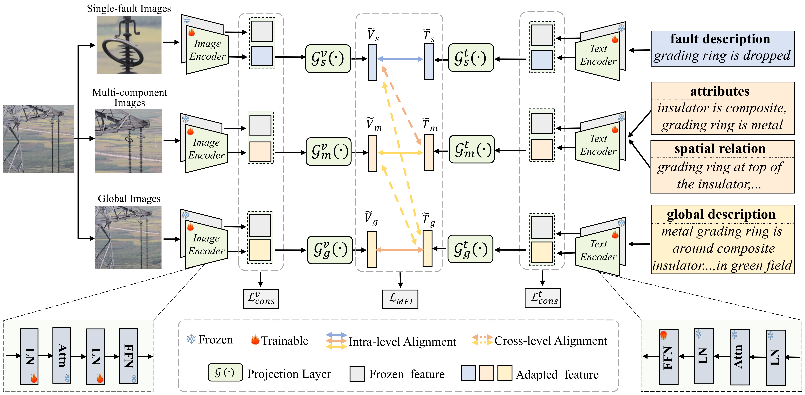
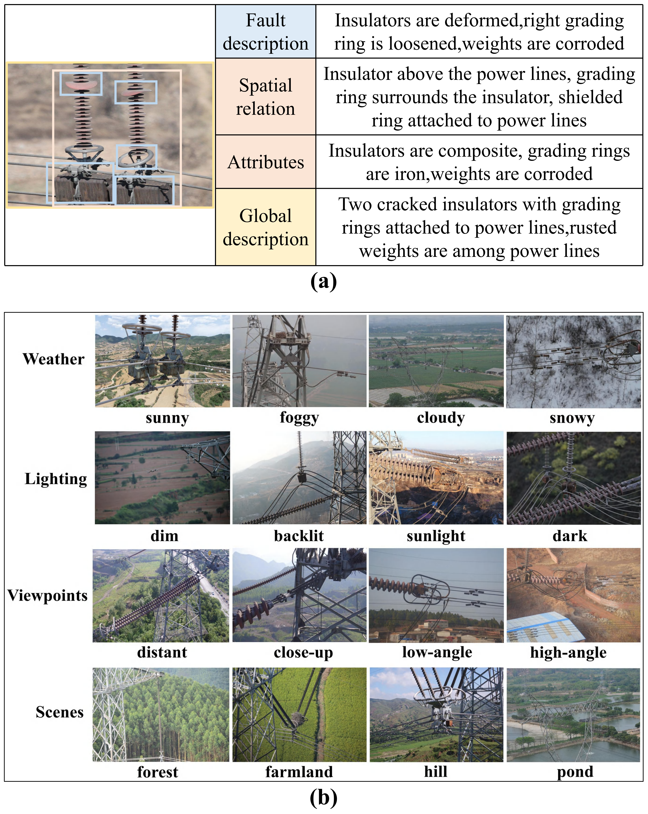
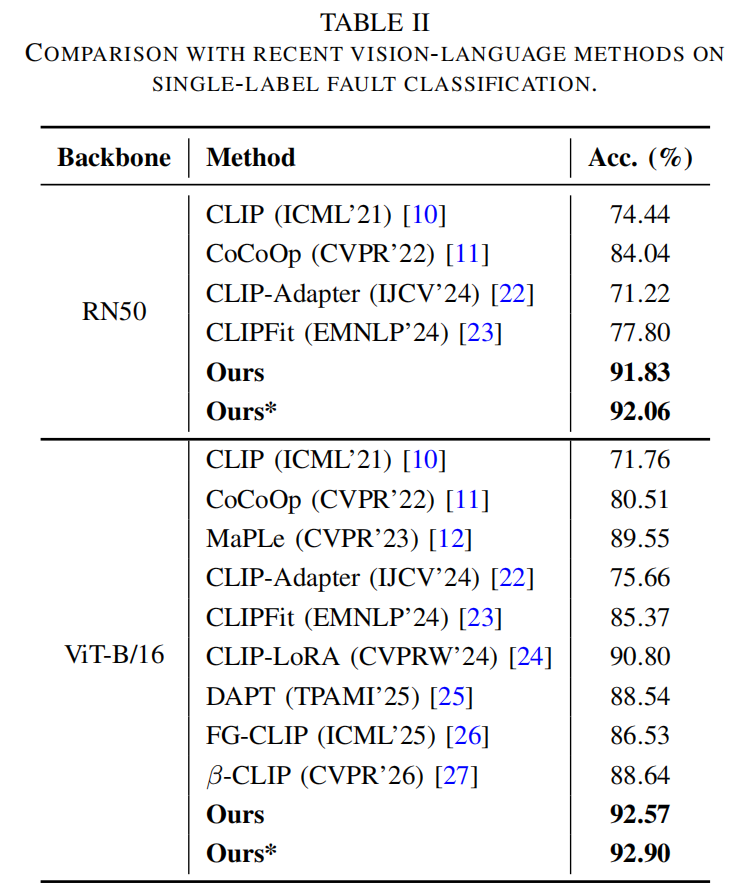
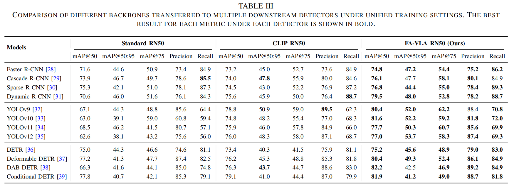
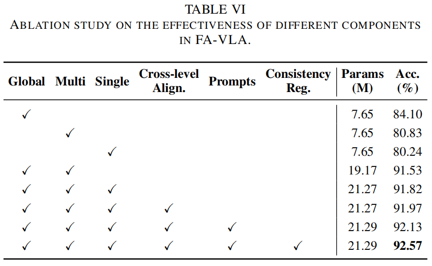
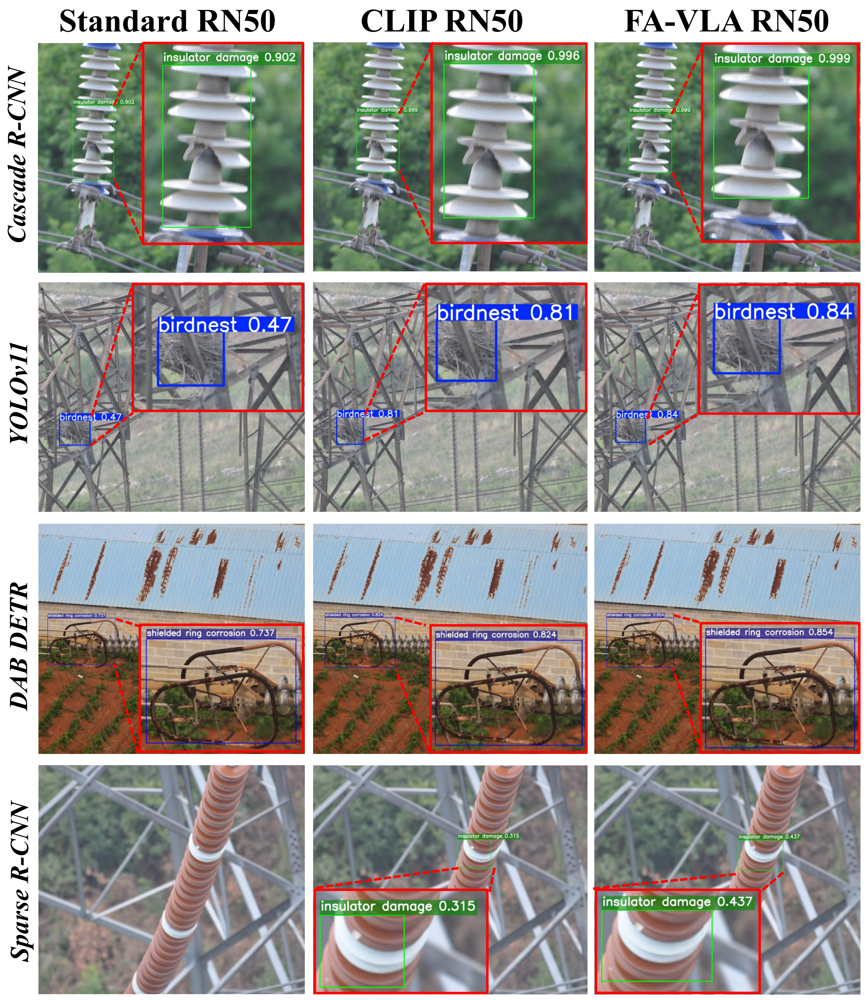
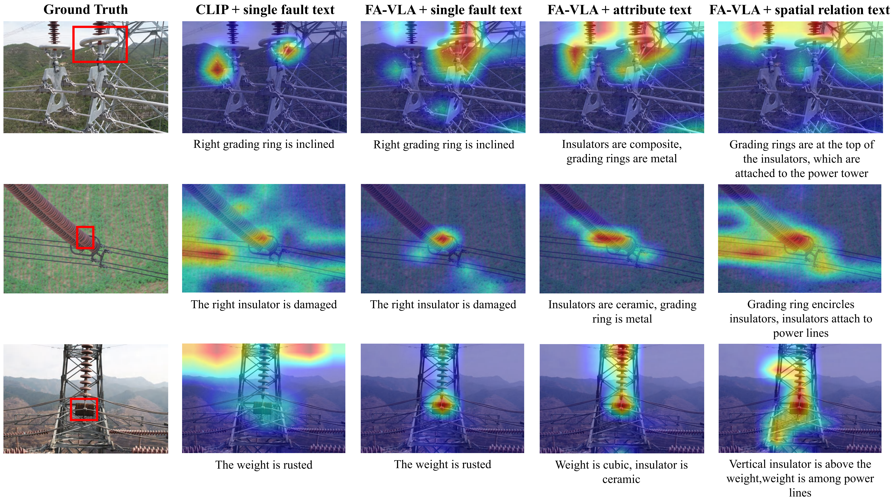

# FA-VLA

### Transmission Line Fault Detection via Multi-Granularity Fault-Semantic Vision-Language Learning

Official project page for **FA-VLA**, a multi-granularity fault-semantic vision-language learning framework for UAV-based transmission line fault detection.

---

## 📖 Overview

FA-VLA aims to enhance transmission line fault detection by learning transferable visual representations from hierarchical fault-semantic descriptions.

The framework integrates multi-granularity visual and textual representations, within-level alignment, cross-level semantic interactions, and feature-consistency regularization to facilitate fault-aware representation learning.

The learned visual backbone can be transferred to different downstream object detectors.

## 🏗️ Framework

The overall architecture of FA-VLA is illustrated below.

FA-VLA incorporates three levels of visual-semantic representations:

- **Single-fault level:** Fine-grained fault characteristics.
- **Multi-component level:** Component attributes and spatial relationships.
- **Global level:** Overall inspection scenes and contextual semantics.

Within-level and cross-level vision-language interactions enable complementary fault-semantic information to guide representation learning.

## 📂 TLI-MGF Dataset

We construct the **TLI-MGF Dataset** to support multi-granularity fault-semantic representation learning for transmission line inspection.

Each inspection image is associated with hierarchical textual descriptions covering fault characteristics, component attributes, spatial relationships, and global scene information.

### Representative Image-Text Annotations

## 📊 Experimental Results

### 1. Comparison with Vision-Language Methods

Comparison of FA-VLA with representative vision-language learning methods on single-label fault-associated target classification.

### 2. Downstream Fault Detection

Evaluation of the learned visual representations across different object detection architectures.

### 3. Ablation Study

Ablation experiments investigate the contributions of different semantic granularities, cross-level interaction, learnable prompts, and feature-consistency regularization.

## 🔍 Qualitative Results

### 1. Fault Detection Visualization

Representative detection results on transmission line inspection images.

### 2. Feature Visualization

Visualization of learned fault-aware representations and their responses to fault-related regions.

---

## 🚧 Project Status

**Coming Soon**

Additional project information and resources are under preparation.

## 📄 Paper

**Title:** Transmission Line Fault Detection via Multi-Granularity Fault-Semantic Vision-Language Learning

Publication information will be updated when available.

## 📚 Citation

Citation information will be provided upon publication.

